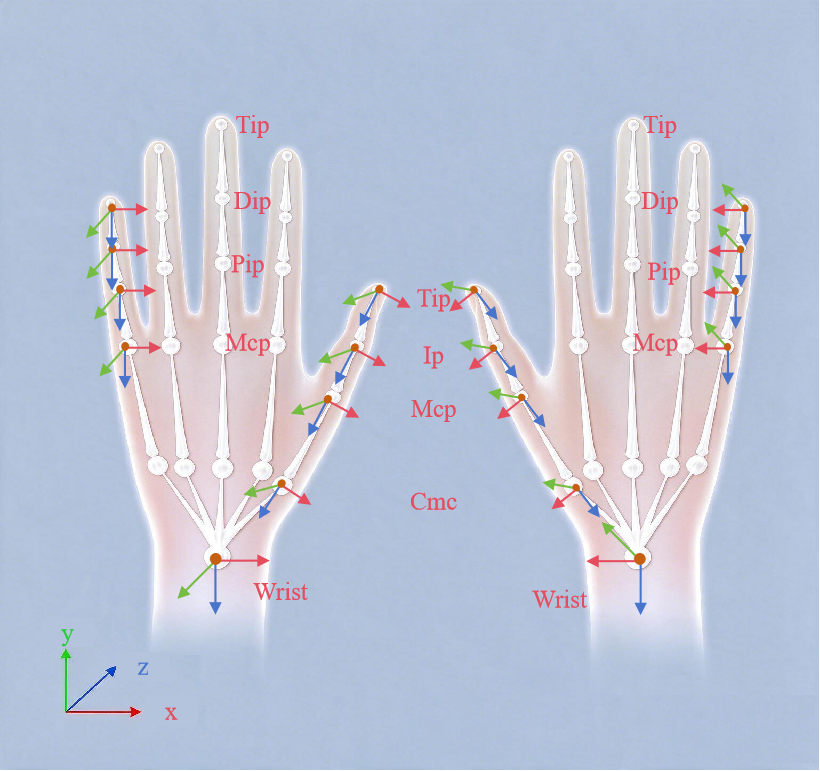

# IK 解算数据描述：坐标系与坐标变换

## 数据与坐标系总览：

1. **输入的一切在发射器系（TX 系）**——系统接收的每个位置与姿态，均为指尖接收器在发射器坐标系下的测量值。

2. **输出的一切空间量在腕系**——手部关键点、指尖目标、腕部姿态全部以当前手的腕坐标系为参考。

3. **系统不输出任何全局位姿**——输出不含机器人基座、房间、相机系下的手腕或指尖位置，需要时由使用方接入外部跟踪。

输入参考系与输出参考系之间由**个人标定**关联：

```Plain Text
手套测量（TX 系） ──个人标定──▶ 腕系 ──▶ 关节角 / 关键点 / 指尖目标
```

各路数据的坐标系对照：

|**数据**|**参考坐标系**|**形式与单位**|
|---|---|---|
|原始指尖RX位姿（输入，每指）|TX 系|位置（米）＋欧拉角（度），内旋 ZYX，顺序 \[yaw, pitch, roll\]|
|原始腕部接收器位姿（输入，可选）|TX 系|同上；姿态用于腕部姿态输出，位置仅作记录|
|21 个关节角（输出）|关节变量（非空间坐标系）|弧度；符号约定见 §2\.4、§3|
|21 个手部关键点位姿（输出）|腕系|位置（米）＋单位四元数 xyzw|
|5 个指尖目标位姿（输出）|腕系|同上；由传感器直接推导，与关键点语义不同、不能混用|
|腕部姿态（输出，可空）|腕系，相对标定零位|四元数 xyzw ＋旋转矩阵|
|录制数据文件|同上各行|同上|

---

## 坐标系约定

### 2\.1 基本约定

- **右手系**：所有坐标系均为右手正交系，与 ROS / 机器人生态兼容（米制、右手定则），可直接接入现有工具链。腕系轴向按手部解剖方向定义（§2\.2），接机器人时仍需一次显式安装变换。

- **单位**：长度米、角度弧度；唯一例外是输入欧拉角为**度**。

- **旋转表示**：输出用单位四元数，分量顺序 **xyzw**（部分生态为 wxyz，接入时务必核对）；输入用欧拉角。

### 2\.2 根节点：腕系（输出参考坐标系）

腕系固定于手模型根部，全部输出共用，轴向按解剖方向定义：

|**轴**|**指向**|
|---|---|
|\+X|桡侧（拇指一侧），左右手相同|
|\+Y|背侧（左手）/ 掌侧（右手），左右手相反|
|\+Z|近端（由指根指向腕与前臂），左右手相同|

**左右腕系互为 Y 镜像**：\+X（桡侧）与 \+Z（近端）语义左右相同，\+Y 语义左右相反——左手 \+Y 为背侧，右手 \+Y 为掌侧。

### 2\.3 发射器 TX 系（输入参考坐标系）

|**轴**|**指向**|
|---|---|
|\+X|左手：桡侧；右手：尺侧，左右手相反|
|\+Y|远端（沿手背指向指根方向），左右手相同|
|\+Z|背侧（垂直手背向外），左右手相同|

- TX 与指环的轴向为**标称安装方向**（设计约定：X 桡 / Y 远 / Z 背）；实际佩戴偏差由个人标定自动吸收，无需手工修正。

- 腕部接收器同样以 TX 系为参考被测量；其自身轴向不参与输出语义，系统只使用它的姿态。

### 2\.4 关节角符号约定

21 个输出关节角是手指关节变量（非空间坐标），符号规则对左右手统一成立：

|**关节**|**正号（\+）**|**负号（−）**|
|---|---|---|
|四指 MCP / PIP / DIP 屈曲|屈曲（指尖弯向掌侧）|伸展|
|四指 MCP 外展|指尖向尺侧（小指方向）偏摆|指尖向桡侧（拇指方向）偏摆|
|拇指 CMC 旋转|向对指方向回转|背离对指方向|
|拇指 CMC / MCP / IP 屈曲|屈曲|伸展|
|拇指 CMC 外展|外展|内收|

---

## 左右手规则

### 3\.1 轴向镜像关系

左右手各有一套镜像的手模型与独立的标定、限位、配置，差异已在模型与标定中内置，运行时不进行任何镜像处理。轴向差异规律：

- **腕系（输出参考）**：\+Y 左右相反（左手背侧、右手掌侧），\+X、\+Z 相同（§2\.2）；

- **发射器 TX 系（输入参考）**：\+X 左右相反（左手桡侧、右手尺侧），\+Y、\+Z 相同（§2\.3）。

两处翻转轴不同，因此不存在仅通过取反或换轴将左手数据转换为右手数据的方法。

### 3\.2 关节角符号一致性

**同名关节、同符号，表示共同的解剖方向。** 左右手均为"屈曲为正"，下游无需对右手关节角整体取负。

同一关节角在左右手上产生一致的解剖动作：屈曲时指尖均转向掌侧，数值上左手指尖向 −Y、右手向 \+Y 移动，物理方向相同。

|**Frame**|**左手**|**右手**|
|---|---|---|
|腕系|X 桡 / Y 背 / Z 近|X 桡 / Y 掌 / Z 近|
|发射器 TX（标称）|X 桡 / Y 远 / Z 背|X 尺 / Y 远 / Z 背|
|指环 RX（标称）|X 桡 / Y 远 / Z 背|X 尺 / Y 远 / Z 背|

### 3\.3 数据互换限制

|**限制**|**说明**|
|---|---|
|标定不可跨手|每只手的标定只能配合该手使用；跨手使用被系统直接拒绝，不静默回退|
|原始数据不可跨手解算|轴向为双重镜像（§3\.1），换轴、取负均无法正确换手；须以对应手的标定重新处理|

---

## Frame 层级结构

### 4\.1 全局层级

系统的坐标系边界是**手腕**：从腕系向远端覆盖整只手（掌＋五指）；腕以上（前臂、身体、机器人本体、房间、相机）不在系统内：

```Plain Text
[世界 / 机器人基座 / 相机]     ← 系统外，使用方接入
        ↑
[腕部跟踪器（Tracker）]        ← 系统外，可选
        ↑ 安装变换（使用方标定）
[腕系 wrist] ★                 ← 系统根 · 全部输出的参考系
        ├── 手部模型层级（§4.2）
        └── 手套传感器层级（§4.3）
```

### 4\.2 手部模型层级

```Plain Text
腕系 wrist ★（根 · 全部输出的参考系）
├── 发射器安装参考位（仅示意）
└── 掌部
    ├── 拇指链（CMC → MCP → IP → 拇指尖）
    ├── 食指链（MCP → PIP → DIP → 食指尖）
    ├── 中指链（MCP → PIP → DIP → 中指尖）
    ├── 无名指链（MCP → PIP → DIP → 无名指尖）
    └── 小指链（MCP → PIP → DIP → 小指尖）
```

### 4\.3 手套传感器层级

传感器通过**个人标定**（固定，一次标定）与**每帧测量**（连续更新）挂接到腕系：

```Plain Text
手腕
└── 发射器 TX 系（输入参考）
    ├──〔每帧测量〕五指指尖接收器
    └──〔每帧测量〕腕部接收器（可选）

发射器 TX 系 ──个人标定──▶ 腕系 ★（输出参考）
```

### 4\.4 输出关键点对照

输出的 21 个关键点取自上述层级的对应关节与指尖，全部在腕系中表达：

|**关键点**|**解剖位置**|**备注**|
|---|---|---|
|Wrist|腕系原点|恒为单位位姿（参考系标记，非外部测量）|
|拇指 CMC / MCP / IP / TIP|腕掌 / 掌指 / 指间关节 / 指尖|每指 4 点|
|四指 MCP / PIP / DIP / TIP|掌指 / 近端指间 / 远端指间关节 / 指尖|每指 4 点，四指顺序为食指，中指，无名指，小拇指|



---


## 传感器安装参数

TX安装参数（以右手为例）：

|**方向**|**参考基准**|**距离**|**说明**|
|---|---|---|---|
|Z\-（远端）|壳体前端|28\.70 mm|指尖方向|
|Z\+（近端）|壳体后端|8\.36 mm|手腕方向|
|X\+（桡侧）|壳体左端|25\.22 mm|拇指方向|
|X\-（尺侧）|壳体右端|25\.10 mm|小指方向|
|Y\-（手掌法向）|壳体顶面|2\.91 mm|手背法线向外|

RX安装参数（以右手为例）：

|**方向**|**参考基准**|**距离**|**说明**|
|---|---|---|---|
|Z\-（远端）|壳体前端|11\.84 mm|指尖方向|
|Z\+（近端）|壳体后端|12\.31 mm|手腕方向|
|X\+（桡侧）|壳体左端|7\.84 mm|拇指方向|
|X\-（尺侧）|壳体右端|7\.95 mm|小指方向|
|Y\-（手掌法向）|壳体顶面|2\.05 mm|指背法线向外|


