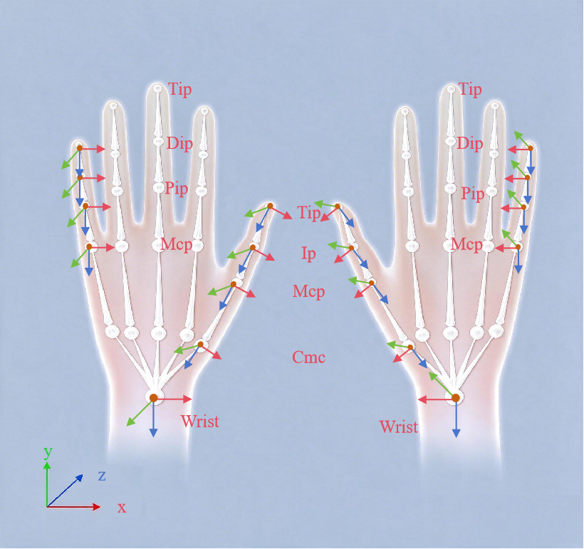

# IK Data: Coordinate Frames and Transforms

## Data and frame overview

1. **All input is in the transmitter (TX) frame.** Every received position and
   orientation is a fingertip receiver measurement relative to TX.
2. **All output spatial quantities are in the wrist frame.** Hand landmarks,
   fingertip targets, and wrist orientation use the current hand's wrist frame.
3. **No global pose is produced.** Output contains no wrist or fingertip pose in
   a robot-base, room, or camera frame. Integrate external tracking if required.

Personal calibration connects input and output frames:

```text
glove measurements (TX) --personal calibration--> wrist frame
                                                   --> joint angles / landmarks / fingertip targets
```

| Data | Reference frame | Representation and unit |
|---|---|---|
| Raw fingertip RX pose (input, each finger) | TX | position in meters + intrinsic ZYX Euler angles in degrees, `[yaw, pitch, roll]` |
| Raw wrist-receiver pose (optional input) | TX | same; orientation contributes to wrist-orientation output, position is recorded only |
| 21 joint angles (output) | joint variables, not a spatial frame | radians; signs follow sections 2.4 and 3 |
| 21 hand-landmark poses (output) | wrist | position in meters + unit quaternion xyzw |
| 5 fingertip target poses (output) | wrist | same; derived directly from sensors and semantically distinct from landmarks |
| Wrist orientation (optional output) | wrist, relative to calibration neutral | quaternion xyzw + rotation matrix |
| Recorded data | frame of each row above | same units |

---

## Coordinate conventions

### 2.1 General conventions

- **Right-handed frames:** every frame is right-handed and orthonormal, using
  meters and the right-hand rule for ROS/robotics compatibility. Wrist axes
  follow anatomy as defined below; mounting to a robot still requires an
  explicit installation transform.
- **Units:** meters for length and radians for angles. Input Euler angles are the
  sole exception and use degrees.
- **Rotation representation:** output uses unit quaternions in **xyzw** order.
  Some systems use wxyz, so verify integration. Input uses Euler angles.

### 2.2 Root: wrist frame (output reference)

The wrist frame is fixed to the hand-model root and shared by all output:

| Axis | Direction |
|---|---|
| +X | radial (thumb side), same for both hands |
| +Y | dorsal for left / palmar for right, opposite between hands |
| +Z | proximal, from finger roots toward wrist/forearm, same for both hands |

The left and right wrist frames are mirrored on Y. +X remains radial and +Z
proximal; left +Y is dorsal while right +Y is palmar.

### 2.3 Transmitter TX frame (input reference)

| Axis | Direction |
|---|---|
| +X | radial for left; ulnar for right |
| +Y | distal, along the hand toward finger roots, same for both hands |
| +Z | dorsal, outward normal to the back of the hand, same for both hands |

- TX and ring axes are nominal installation directions: X radial, Y distal, Z
  dorsal. Personal calibration absorbs actual wearing offsets; do not correct
  them manually.
- The wrist receiver is also measured relative to TX. Its own axes are not part
  of output semantics; only its orientation is used.

### 2.4 Joint-angle signs

The 21 joint outputs are joint variables, not spatial coordinates. Signs have
the same anatomical meaning on both hands:

| Joint | Positive (+) | Negative (-) |
|---|---|---|
| Four-finger MCP/PIP/DIP flexion | flexion toward palm | extension |
| Four-finger MCP abduction | fingertip toward ulnar/little-finger side | fingertip toward radial/thumb side |
| Thumb CMC rotation | rotation toward opposition | away from opposition |
| Thumb CMC/MCP/IP flexion | flexion | extension |
| Thumb CMC abduction | abduction | adduction |

---

## Left/right rules

### 3.1 Mirroring

Each hand has its own mirrored model, calibration, limits, and configuration.
No runtime mirroring is applied:

- wrist output: Y reverses between hands; X and Z retain their anatomical meaning;
- TX input: X reverses between hands; Y and Z retain their meaning.

Because different axes flip in the two frames, left-hand data cannot be
converted correctly to right-hand data through a simple sign or axis swap.

### 3.2 Consistent joint signs

The same named joint and sign always describe the same anatomical direction.
Flexion is positive for both hands; downstream users must not negate every
right-hand joint. During flexion fingertips move numerically toward -Y for the
left and +Y for the right, while the physical motion is the same.

| Frame | Left hand | Right hand |
|---|---|---|
| Wrist | X radial / Y dorsal / Z proximal | X radial / Y palmar / Z proximal |
| TX, nominal | X radial / Y distal / Z dorsal | X ulnar / Y distal / Z dorsal |
| Ring RX, nominal | X radial / Y distal / Z dorsal | X ulnar / Y distal / Z dorsal |

### 3.3 Cross-hand restrictions

| Restriction | Meaning |
|---|---|
| Calibration is hand-specific | A calibration is accepted only for its hand; cross-hand use is rejected without fallback. |
| Raw data cannot be solved for the other hand | The double mirroring above cannot be corrected by swaps or negation; process it with that hand's calibration. |

---

## Frame hierarchy

### 4.1 Global boundary

The system boundary is the wrist. The palm and five fingers distal to it are in
scope; forearm, body, robot, room, and camera frames are not:

```text
[world / robot base / camera]      outside system; integrated by user
        ^
[wrist tracker]                    outside system; optional
        ^ user-calibrated mounting transform
[wrist frame] *                    system root; all output is relative here
        +-- hand-model hierarchy (4.2)
        +-- glove-sensor hierarchy (4.3)
```

### 4.2 Hand-model hierarchy

```text
wrist * (root and output reference)
+-- transmitter mounting reference (illustrative only)
+-- palm
    +-- thumb chain  (CMC -> MCP -> IP -> thumb tip)
    +-- index chain  (MCP -> PIP -> DIP -> index tip)
    +-- middle chain (MCP -> PIP -> DIP -> middle tip)
    +-- ring chain   (MCP -> PIP -> DIP -> ring tip)
    +-- little chain (MCP -> PIP -> DIP -> little tip)
```

### 4.3 Glove-sensor hierarchy

Personal calibration is fixed after capture; per-frame measurements update
continuously:

```text
wrist
+-- transmitter TX (input reference)
    +-- five fingertip receivers [measured each frame]
    +-- optional wrist receiver  [measured each frame]

TX --personal calibration--> wrist * (output reference)
```

### 4.4 Output landmarks

All 21 landmarks are expressed in the wrist frame:

| Landmark | Anatomical location | Note |
|---|---|---|
| Wrist | wrist-frame origin | always identity; a frame marker, not an external measurement |
| Thumb CMC/MCP/IP/TIP | carpometacarpal / metacarpophalangeal / interphalangeal / fingertip | four points |
| Four-finger MCP/PIP/DIP/TIP | metacarpophalangeal / proximal interphalangeal / distal interphalangeal / fingertip | four each, ordered index, middle, ring, little |



---

## Sensor installation parameters

TX installation dimensions, using the right hand as example:

| Direction | Reference | Distance | Meaning |
|---|---|---|---|
| Z- (distal) | housing front | 28.70 mm | fingertip direction |
| Z+ (proximal) | housing rear | 8.36 mm | wrist direction |
| X+ (radial) | housing left | 25.22 mm | thumb direction |
| X- (ulnar) | housing right | 25.10 mm | little-finger direction |
| Y- (palm normal) | housing top | 2.91 mm | outward dorsal normal |

RX installation dimensions, using the right hand as example:

| Direction | Reference | Distance | Meaning |
|---|---|---|---|
| Z- (distal) | housing front | 11.84 mm | fingertip direction |
| Z+ (proximal) | housing rear | 12.31 mm | wrist direction |
| X+ (radial) | housing left | 7.84 mm | thumb direction |
| X- (ulnar) | housing right | 7.95 mm | little-finger direction |
| Y- (palm normal) | housing top | 2.05 mm | outward finger-back normal |
