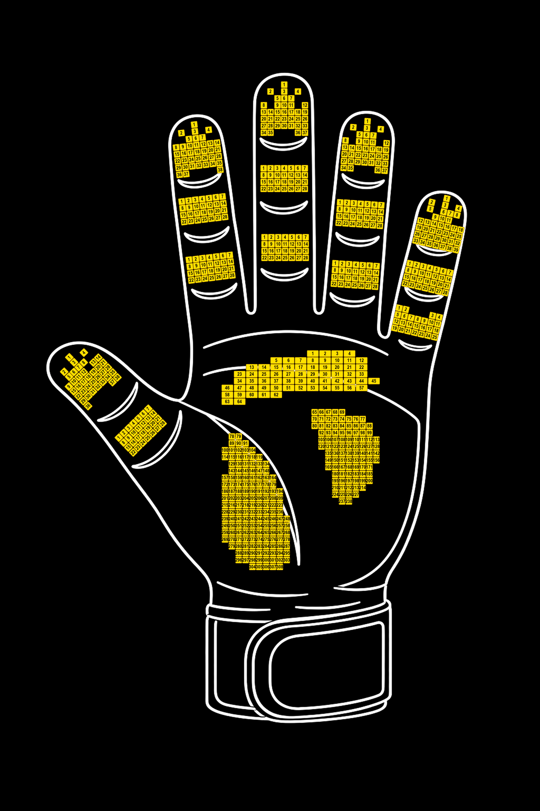
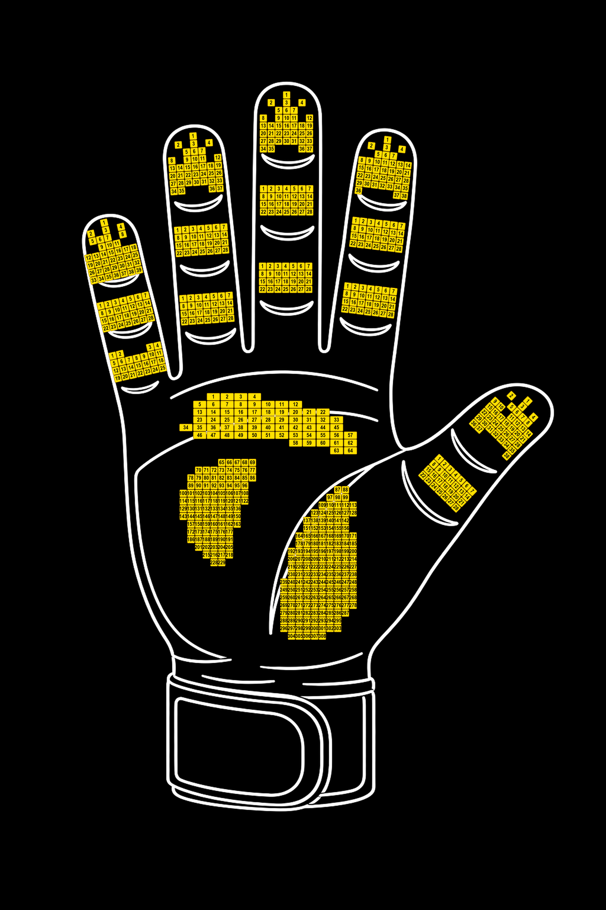
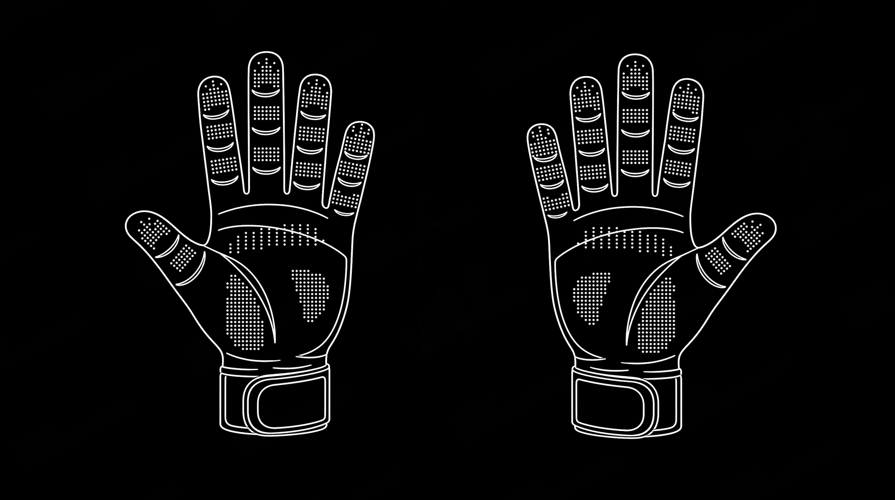

# T1.5 Tactile-Point Mapping Images

These diagrams show tactile points on the palm side of both T1.5 hands.
Each hand has 746 valid points read through the SDK's 15 regions: `tip` is
the fingertip, `pad` the finger pad, `middle` the little-finger middle
region, `root` the finger root, and `palm.surface` the palm surface.

Yellow numbers are local point indices in the current region. Each region
starts independently at 1; the palm surface uses 1 through 308. These numbers
are indices, not tactile measurements. Each valid point has a value range of
`0..255` with a resolution of `1 g/LSB`.

## Reading values from the diagrams

1. Select the left or right diagram using the sample's `hand`. Both show the
   palm side.
2. Identify the region and yellow local index `k`, then read that region's
   `data[k-1]`.
3. For a global index or a POSE mode 1 position, use the region's starting
   offset `a`: `i=a+k-1`, paired with `tac_pos.points[i]`.

For example, index 1 on the index-finger pad reads `index.pad.data[0]`
and has global index 104. Palm index 1 reads `palm_surface.data[0]`
in DIRECT / ROS 2 or `palm.surface.data[0]` in UDP and has global index 438.

Some fingertip and palm layouts differ between hands. Use each hand's listed
indices without mirroring the left-hand data array to obtain right-hand data.
See [Tactile-Point Layout v1](./TACTILE_LAYOUT_V1.md) for exact region counts,
matrix bounds, and global slices, and [DIRECT / UDP Data Formats](./STREAM_DATA_V1.md)
for output fields.

## Left hand

Left palm side. Fingertip, pad, middle, and root indices each start
independently at 1. All three palm point clusters share the `palm.surface`
indices 1 through 308.

## Right hand

Right palm side. Match yellow indices using the right-hand matrices.
Region counts and global slices are the same as for the left hand.

## Physical point distribution

White dots show the physical tactile-sensor locations. The left hand is on the
left and the right hand on the right, both viewed from the palm side.
Use this overview to inspect coverage and the yellow maps above to read indices.

